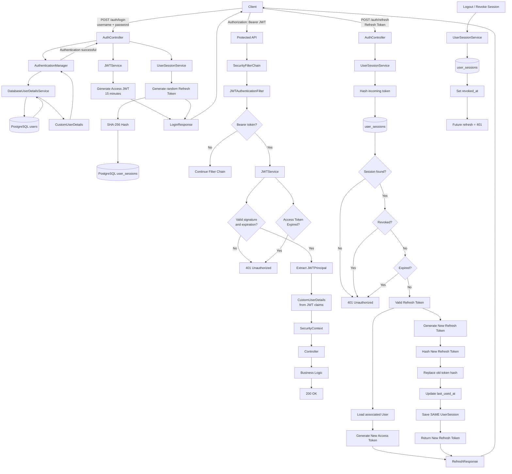

# Spring Boot Expense Tracker — Authentication & JWT

A Spring Boot expense tracker demonstrating modern backend practices, including **Spring Security, JWT authentication, refresh tokens, refresh-token rotation, PostgreSQL, Flyway, JPA, and stateless API security**.

The authentication system was intentionally built incrementally to understand what Spring Security is doing underneath its defaults rather than simply relying on auto-configuration.

---

## Authentication Architecture

The authentication system uses two types of tokens:

* **Access Token** — short-lived JWT used to access protected APIs.
* **Refresh Token** — long-lived, opaque token used to obtain a new access token.

The access token currently expires after **15 minutes**, while refresh sessions currently have a **30-day lifetime**.



---

## 1. Login

The client sends credentials to:

```http
POST /auth/login
Content-Type: application/json

{
  "username": "admin",
  "password": "********"
}
```

The request goes through Spring Security's `AuthenticationManager`.

```text
Client
  │
  │ username + password
  ▼
AuthController
  │
  ▼
AuthenticationManager
  │
  ▼
DatabaseUserDetailsService
  │
  ▼
UserRepository
  │
  ▼
PostgreSQL
  │
  ▼
CustomUserDetails
  │
  ▼
PasswordEncoder
```

If authentication succeeds, the application generates:

```text
Access Token
+
Refresh Token
```

The response looks like:

```json
{
  "accessToken": "...",
  "refreshToken": "...",
  "accessTokenExpiresIn": 900,
  "refreshTokenExpiresAt": "2026-11-15T08:00:00"
}
```

* `accessTokenExpiresIn` is the access token's lifetime in seconds (`app.jwt.expiration`, 15 minutes),
  counted from now. A client can refresh a little before it runs out without decoding the JWT.
* `refreshTokenExpiresAt` is when the session ends: its `expires_at`, login time plus
  `app.session.lifetime` (30 days). Like every API timestamp it is UTC written without an offset (see
  section 17), so read it as `2026-11-15T08:00:00Z`. After that the person has to log in again.

`POST /auth/refresh` returns the same four fields. Refreshing does not extend the session, so its
`refreshTokenExpiresAt` is always the value login returned.

### Login rate limit

`LoginRateLimiter` checks two token buckets (Bucket4j) before the password is checked:

| Bucket | Default | What it stops |
| --- | --- | --- |
| per username (stripped, any case), only failures count | 5 per 15 minutes | guessing one account's password from many IPs |
| per client IP, every attempt counts | 20 per minute | trying many accounts from one IP |

Over either limit the answer is `429 TOO_MANY_REQUESTS` (the usual `ErrorResponse` body) with a
`Retry-After` header in seconds. Tokens come back gradually (5 per 15 minutes is one every 3 minutes).

* A successful login gives its username token back, so a user is never locked out by their own logins.
* Unknown usernames are limited the same way, so a 429 doesn't reveal which accounts exist.
* While a username is locked, even the right password gets 429 until a token comes back. An attacker can
  lock someone out this way for as long as they keep guessing; the IP limit slows that down.
* The client IP is `request.getRemoteAddr()`, which behind a trusted proxy is the forwarded client IP.
* The bucket key is that IP as is for IPv4, but an IPv6 client is keyed by its **/64 prefix**
  (`ClientIpKey`): one host usually controls a whole /64, so per-address buckets could be dodged by
  rotating addresses. A zone id (`%eth0`) is dropped, an IPv4-mapped address (`::ffff:192.0.2.1`) counts
  as its IPv4 address, and a value that doesn't parse is used unchanged. Sessions still store the full
  address. The same key is used by the per-IP limits below.
* Limits are set in `app.rate-limit.*` (`application.yml`). Each map keeps at most
  `app.rate-limit.max-keys` entries and drops a key once its bucket is full again, so random usernames
  can't grow memory forever.
* The buckets live in memory, **per instance**: fine for one instance, but with several each counts on its
  own (and a restart resets them). A shared limit would need a shared store such as Redis.

### Other auth endpoints

`AuthEndpointRateLimiter` limits the other public auth endpoints per client IP, with one bucket per
endpoint. Every request counts, failed or not, and the answer over the limit is the same `429` with
`Retry-After`. An IPv6 client is counted by its /64, like at login.

| Endpoint | Default | Why |
| --- | --- | --- |
| `POST /auth/register` | 10 per hour | strict: stops mass account creation from one IP |
| `POST /auth/refresh` | 60 per minute | loose: each open tab refreshes every 15 minutes, and users behind NAT share an IP |
| `POST /auth/logout` | 60 per minute | loose, like refresh |

They are set in `app.rate-limit.register|refresh|logout.client-ip` and live in memory per instance like
the login buckets.

### Password change rate limit

`PasswordChangeRateLimiter` limits wrong current passwords on `POST /users/me/password` to **5 per 15
minutes per user**, so someone holding a stolen access token can't guess the password at BCrypt speed and
then take the account over by setting a new one.

* The key is the user's `unique_id` from the access token, not a username from the request body, so only a
  caller already authenticated as that user can use up the bucket. Nobody can lock someone else out.
* Only failures count: a right current password gives its token back, even when the new password is
  then rejected.
* The token is taken before the password is checked, so while the limit holds even the right current
  password gets `429 TOO_MANY_REQUESTS` with `Retry-After`.
* Set in `app.rate-limit.password-change.failures`; in memory per instance like the other buckets.

---

## 2. Access Token

The access token is a JWT signed with HS256 (HMAC-SHA256) using `JWT_SECRET`.

The algorithm is pinned: jjwt would otherwise pick HS384 or HS512 for a secret of 48 or 64+ bytes, so a
longer secret still gives `"alg": "HS256"`. The parser checks the header `alg` and rejects any other
algorithm, even one that verifies with the same key.

The current claims are approximately:

```json
{
  "sub": "admin",
  "uid": "019f47ca-...",
  "role": "ADMIN",
  "sid": "5b0c1c1e-...",
  "iss": "expense-tracker",
  "iat": 1783893415,
  "exp": 1783894315
}
```

`iss` is always `expense-tracker` and is required, so a token from another service that shares the secret
is rejected. Tokens issued before `iss` was added have none and are rejected too: after that deploy each
client gets one 401 and calls `/auth/refresh`, which needs no access token, so nobody is logged out.

`sid` is the `unique_id` of the session the token belongs to. It is optional: tokens issued before the
claim existed have none, and a `sid` that is not a UUID is rejected. It stays the same when the refresh
token rotates.

The token contains enough information for the application to reconstruct the authenticated user's security identity without querying the database on every API request.

### Why?

For a normal protected request:

```text
JWT
 │
 ▼
JWTAuthenticationFilter
 │
 ▼
Validate JWT
 │
 ▼
Extract JWTPrincipal
 │
 ▼
CustomUserDetails
 │
 ▼
SecurityContext
 │
 ▼
Controller
```

There is **no database lookup** in this path.

This is one of the major benefits of our JWT-based authentication design.

---

## 3. JWT Authentication Filter

The custom filter is registered before Spring Security's `UsernamePasswordAuthenticationFilter`:

```java
.addFilterBefore(
    jwtAuthenticationFilter,
    UsernamePasswordAuthenticationFilter.class
)
```

The filter:

1. Reads the `Authorization` header.
2. Checks for `Bearer`.
3. Validates the JWT.
4. Extracts the principal.
5. Creates `CustomUserDetails`.
6. Places the authentication into the `SecurityContext`.
7. Continues the filter chain.

Conceptually:

```text
Authorization: Bearer <JWT>
                │
                ▼
       JWTAuthenticationFilter
                │
                ▼
          JWTService
                │
        ┌───────┴───────┐
        │               │
      Invalid          Valid
        │               │
        ▼               ▼
       401       JWTPrincipal
                        │
                        ▼
                SecurityContext
```

---

## 4. Access Token Expiration

The access token is intentionally short-lived.

Current lifetime:

```text
15 minutes
```

After expiration:

```text
Client
  │
  │ expired JWT
  ▼
JWTAuthenticationFilter
  │
  ▼
JWTService
  │
  ▼
Token expired
  │
  ▼
401 Unauthorized
```

The client does **not** need to ask the user for their password again.

Instead, it can use the refresh token.

---

# 5. Refresh Token

Unlike the access token, the refresh token is an **opaque random value**.

Example:

```text
068qm1ObvWUe4XGiWx-7TQyyoNfKRc5HvBuU39eVv4s
```

The server does not store this raw value.

Instead:

```text
Raw Refresh Token
        │
        ▼
     SHA-256
        │
        ▼
refresh_token_hash
```

The database contains something like:

```text
9147865562814002bde65322ba00e55cd96cbb45dbfc817c2e6dba5ff1ab4374
```

This means a database compromise does not immediately expose usable refresh tokens.

A session, and so its refresh token, lasts 30 days from login; refreshing does not extend it. The session
settings are in `application.yml` under `app.session` (a `Duration` like `30d` or `12h` for the times),
next to `app.jwt.expiration` for the access token:

| Property | Default | Meaning |
| --- | --- | --- |
| `app.session.lifetime` | `30d` | how long a session lasts from login |
| `app.session.max-active` | `10` | most active sessions per user; a login past it revokes the least recently used |
| `app.session.retention` | `7d` | how long expired or revoked sessions are kept before the nightly cleanup deletes them |

---

# 6. User Sessions

Refresh tokens are associated with persistent sessions.

`unique_id` is a random (v4) UUID and is the only session id exposed through the API; `id` stays internal.

Current table:

```text
user_sessions

id
unique_id
user_id
refresh_token_hash
user_agent
ip_address
created_at
last_used_at
expires_at
revoked_at
```

A session represents a **login/device session**, rather than every individual refresh-token generation.

For example:

```text
User #1

Session #1 → Chrome
Session #2 → Phone
Session #3 → Tablet
```

This allows individual sessions to be revoked.

For example:

```text
Chrome  → revoked
Phone   → active
Tablet  → active
```

---

# 7. Multiple Simultaneous Sessions

A user can have multiple refresh tokens simultaneously.

```text
                    User
                     │
        ┌────────────┼────────────┐
        ▼            ▼            ▼
     Chrome        Phone        Tablet
        │            │            │
   Session #1    Session #2    Session #3
        │            │            │
   Refresh A     Refresh B     Refresh C
```

This is important for session management.

Logging out from Chrome does not have to invalidate the user's phone session.

---

# 8. Refresh Flow

When the access token expires:

```http
POST /auth/refresh
Content-Type: application/json

{
  "refreshToken": "..."
}
```

The server:

```text
Refresh Token
      │
      ▼
SHA-256
      │
      ▼
Find UserSession
      │
      ├── Not found ──► is it an old (rotated) token of a session?
      │                   ├── No (never issued, or pruned beyond the newest 20) ──► 401
      │                   ├── Yes, session already ended ──► 401 (quiet, DEBUG log)
      │                   └── Yes, session still active ──► reuse detected:
      │                                                     revoke the session ──► 401
      │
      ├── Revoked ────► 401
      │
      ├── Expired ────► 401
      │
      ├── User disabled ──► revoke the session ──► 401
      │
      ▼
Valid Session
      │
      ▼
Rotate the refresh token (old hash saved, newest 20 kept)
      │
      ▼
Associated User
      │
      ▼
Generate New Access Token
```

Section 11 covers the reuse branch in detail.

---

# 9. Refresh Token Rotation

Refresh tokens are **rotated** after successful use.

Suppose the client currently has:

```text
Refresh Token A
```

The database contains:

```text
hash(A)
```

After a successful refresh:

```text
Refresh A
    │
    ▼
Validate
    │
    ├──────────────► New Access Token
    │
    ▼
Generate Refresh B
    │
    ▼
Hash B
    │
    ▼
Replace hash(A)
with hash(B)
```

The same `UserSession` remains:

```text
Before:

Session #1
refresh_token_hash = hash(A)


After:

Session #1
refresh_token_hash = hash(B)
```

The session itself is not recreated.

---

# 10. Why Rotation Matters

Without rotation:

```text
Refresh A
   │
   ├── refresh ──► Access B
   │
   ├── refresh ──► Access C
   │
   └── refresh ──► Access D
```

Refresh token A remains usable for its entire lifetime.

With rotation:

```text
Refresh A
   │
   ▼
Refresh B
   │
   ▼
Refresh C
   │
   ▼
Refresh D
```

Each refresh token is intended to be used once.

Therefore:

```text
A → B
```

means the old `A` is no longer valid.

---

# 11. Refresh Token Reuse

Rotation also gives us an important security signal.

Suppose an attacker steals Refresh Token A.

Both the legitimate client and attacker possess:

```text
Refresh A
```

If the attacker uses it first:

```text
Attacker
   │
   │ Refresh A
   ▼
Server
   │
   ▼
A → B
```

The legitimate client still has A.

If it later sends A:

```text
Refresh A
   │
   ▼
Server
   │
   ▼
hash(A) is not the current token of any session
   │
   ▼
hash(A) found in used_refresh_tokens
   │
   ▼
Refresh token reuse detected
```

Every time a token is rotated, the hash of the old token is saved in `used_refresh_tokens`, linked to its session.
Only the newest 20 used hashes per session are kept (`MAX_USED_TOKENS_PER_SESSION`); each rotation deletes older ones, so a client looping on `/auth/refresh` cannot grow the table without bound.
A token older than that is no longer recognized: it gets a plain `401` like an unknown token, and the session is not revoked. That is acceptable because such a token stopped being current long ago.

A previously valid token being presented again can indicate that a token was stolen, so the server:

```text
Refresh Token Reuse Detected
            │
            ▼
Possible Token Theft
            │
            ▼
Revoke the Session
            │
            ▼
401 Unauthorized
```

The whole session is revoked, so both the attacker and the legitimate client are logged out and the real user must log in again.
This only happens while the session is still active. If it already ended (logged out, revoked or expired), a replayed old token gets a plain `401`, logged at DEBUG: there is nothing left to protect, the original revocation time is kept, and the `Refresh token reuse detected` WARN stays a meaningful alert. Of several concurrent replays, only the one that actually revokes the session logs the WARN.
A token the server has never issued is simply rejected with `401 Unauthorized`.

Other details of `UserSessionService.rotateRefreshToken`:

- The session row is locked (`findForUpdateByRefreshTokenHash`) inside one transaction, so two concurrent refreshes with the same token cannot both succeed. The second one waits, then sees the token as already used.
- The session revoke is not rolled back when the reuse is rejected (`noRollbackFor`).
- A revoked or expired session is rejected with `401`.
- If the user has been disabled, the session is revoked and the refresh is rejected, so re-enabling the account does not bring the session back.
- `POST /auth/logout` revokes the session of the given refresh token, also when that token was already rotated (a lost refresh response or a stale tab); that is the owner logging out, so it is not treated as reuse. It always returns `204`, even for unknown tokens, and the access token stays valid until it expires.
- A nightly job (`UserSessionCleanup`, once at 3AM, in batches of 1,000 until none are left, at most 100 batches a run) deletes sessions that expired or were revoked more than 7 days ago (`app.session.retention`), together with their used token hashes. Active sessions are never deleted.

---

# 12. Session Revocation

A session can be revoked by setting:

```text
revoked_at = CURRENT_TIMESTAMP
```

For example:

```sql
UPDATE user_sessions
SET revoked_at = CURRENT_TIMESTAMP
WHERE id = 1;
```

The refresh token associated with that session can no longer be used.

Clients log out by sending their refresh token:

```http
POST /auth/logout
Content-Type: application/json

{
  "refreshToken": "..."
}
```

This revokes only that session (other devices stay logged in) and always returns
`204 No Content`, even for unknown tokens, so the endpoint can't be used to probe tokens.
No access token is required, so a client can still log out after its JWT has expired.
The access token itself stays valid until it expires (at most 15 minutes).

```text
Refresh Token
      │
      ▼
UserSession
      │
      ▼
revoked_at != NULL
      │
      ▼
401 Unauthorized
```

Logout needs the refresh token. Logged-in users can also list and revoke their sessions without it
(`GET /users/me/sessions`, `DELETE /users/me/sessions[/{sessionId}]`), and admins can do the same for any
user (`GET`/`DELETE /users/{id}/sessions[/{sessionId}]`). See section 17, "Sessions".

---

# 13. Authentication vs Authorization

The project also distinguishes between authentication and authorization.

### Authentication

> "Who are you?"

Examples:

```text
Username + Password
JWT
Refresh Token
```

Failure:

```http
401 Unauthorized
```

### Authorization

> "Are you allowed to do this?"

For example:

```text
Authenticated user
        │
        ▼
ROLE_USER
        │
        ▼
Admin-only endpoint
        │
        ▼
403 Forbidden
```

This distinction is important when working with Spring Security.

---

# 14. Spring Security Responsibilities

The application intentionally separates responsibilities.

```text
Spring Security
│
├── Authentication
│   ├── AuthenticationManager
│   ├── UserDetailsService
│   └── PasswordEncoder
│
├── JWT authentication
│   └── JWTAuthenticationFilter
│
├── Authorization
│   ├── SecurityContext
│   ├── Roles
│   └── @PreAuthorize
│
└── HTTP security failures
    ├── 401 Unauthorized
    └── 403 Forbidden
```

Meanwhile, application-level exceptions are handled separately:

```text
GlobalExceptionHandler
│
├── ResourceNotFoundException                  → 404 (code from the exception)
├── MethodArgumentNotValidException            → 400 VALIDATION_ERROR (one "field: message" per bean validation failure)
├── BadRequestException                        → 400 (code from the exception)
├── DateTimeParseException                     → 400 VALIDATION_ERROR
├── MethodArgumentTypeMismatchException        → 400 VALIDATION_ERROR ("name: invalid value")
├── MissingServletRequestParameterException    → 400 VALIDATION_ERROR ("name: is required")
├── HttpMessageNotReadableException            → 400 MALFORMED_REQUEST
├── BusinessRuleException                      → 409 (code from the exception)
├── ObjectOptimisticLockingFailureException    → 409 CONCURRENT_MODIFICATION
├── AccessDeniedException (@PreAuthorize)      → 403 ACCESS_DENIED
└── TooManyRequestsException                   → 429 TOO_MANY_REQUESTS (with a Retry-After header)
```

Failed authentication (bad credentials, bad or revoked refresh token, disabled user) is not handled here; it is a 401 from the authentication layer.

This keeps security infrastructure separate from business-domain error handling.

### Health endpoint

`GET /actuator/health` is the one public endpoint outside `/auth`, for the Docker Compose
healthcheck and a reverse proxy. It answers `{"status":"UP"}` (200) or `{"status":"DOWN"}` (503,
e.g. when Postgres is unreachable) and nothing else: no component details, not even for admins
(`show-details: never`). Only `health` is exposed, so other actuator endpoints such as
`/actuator/env` or `/actuator/beans` are 401 without a token and 404 with one. The `permitAll`
covers exactly `/actuator/health`; paths below it stay authenticated.

---

# 15. Stateless API

The application uses:

```java
.sessionManagement(session ->
    session.sessionCreationPolicy(
        SessionCreationPolicy.STATELESS
    )
)
```

Therefore the server does not use an HTTP session to maintain authentication state.

The authentication state is represented by:

```text
Access JWT
```

while long-lived authentication continuity is represented by:

```text
Refresh Token + UserSession
```

This is why the application can remain stateless for normal API authentication while still supporting long-lived login sessions.

---

# 16. Complete Lifecycle

The complete lifecycle can be summarized as:

```text
                    ┌──────────────┐
                    │    LOGIN     │
                    └──────┬───────┘
                           │
               username + password
                           │
                           ▼
                  AuthenticationManager
                           │
                           ▼
                 DatabaseUserDetailsService
                           │
                           ▼
                      User Database
                           │
                           ▼
                    Authentication OK
                           │
             ┌─────────────┴─────────────┐
             ▼                           ▼
       Access Token                 Refresh Token
        15 minutes                    30 days
             │                           │
             ▼                           ▼
        API Requests                UserSession
             │                           │
             ▼                           ▼
     JWTAuthenticationFilter        PostgreSQL
             │                           │
             ▼                           │
      Validate JWT                       │
             │                           │
        ┌────┴────┐                      │
        ▼         ▼                      │
     Valid      Expired                  │
        │         │                      │
        ▼         ▼                      │
 SecurityContext  401                    │
        │                                │
        ▼                                │
    Controller                           │
        │                                │
        ▼                                │
      200 OK                             │
                                         │
                                  Access token expires
                                         │
                                         ▼
                                  /auth/refresh
                                         │
                                         ▼
                                  Validate session
                                         │
                              ┌──────────┴──────────┐
                              ▼                     ▼
                           Invalid                Valid
                              │                     │
                              ▼                     ▼
                             401              Rotate token
                                                    │
                                       ┌────────────┴────────────┐
                                       ▼                         ▼
                                New Access JWT             New Refresh Token
                                       │                         │
                                       └────────────┬────────────┘
                                                    │
                                                    ▼
                                                 Client
                                                    │
                                                    ▼
                                                Repeat
```

---

# 17. User Accounts, Roles and Admin Endpoints

Every error below uses the same JSON body as the rest of the API: `{"code": "...", "messages": [...], "timestamp": "..."}`.

**Timestamps are UTC.** Every timestamp in a response (`createdAt`, `lastModified`, `expiresAt`, the error
`timestamp`, ...) is a UTC time written without an offset, e.g. `"2026-10-16T08:00:00"`: read it as
`2026-10-16T08:00:00Z`. The app takes "now" from one UTC `Clock` bean, so the host's time zone doesn't matter.
Bean validation uses the same clock: an expense `date` must not be after today in UTC+14 (the earliest zone), so a
user ahead of UTC can record an expense dated today.
Adding the `Z` would change the response format, so it waits for a new API version.
Request bodies that fail bean validation (blank fields, missing `version`) return `400 VALIDATION_ERROR`.
So do a malformed path variable or query parameter (`/users/not-a-uuid`, `?page=abc`) and a missing
required query parameter. An unreadable body (malformed JSON, unknown enum value) returns
`400 MALFORMED_REQUEST`.

## Registration

```http
POST /auth/register
Content-Type: application/json

{ "username": "alice", "password": "a-long-password" }
```

* No access token needed. Always creates a `USER` (never an `ADMIN`), enabled.
* `201 Created` with `{ id, username, role, createdAt }`. `id` is the user's `unique_id` (UUID), never the
  database id. No tokens are returned; the client calls `/auth/login` next.
* `409 USERNAME_TAKEN` if the name exists in any letter case. Usernames are unique ignoring case
  (index added in V11), so `alice` is taken once `Alice` exists. Login matches the username in any case.
* `400 INVALID_PASSWORD` if the password has fewer than 12 characters, more than 72 bytes in UTF-8
  (the BCrypt limit), or equals the username ignoring case. The same rules apply to a password change.
* `username` is required and at most 100 characters (otherwise `VALIDATION_ERROR`).
* The username is stripped of leading and trailing whitespace, then may only contain `A-Z`, `a-z`, `0-9`,
  `.`, `_` and `-` (otherwise `400 INVALID_USERNAME`). This rules out lookalikes such as `alice ` next to
  `alice`, invisible characters like a zero-width space, and newlines that would split log lines.
* Login strips the username too, so ` alice ` logs in as `alice`. Login does not apply the character rule:
  it first tries the exact name, so accounts created before the rule (or the `ADMIN_USERNAME` admin) keep
  working.
* Registration is rate limited to 10 per hour per client IP (`429 TOO_MANY_REQUESTS` with `Retry-After`,
  see [Other auth endpoints](#other-auth-endpoints)).

## Roles

There are two roles, `USER` and `ADMIN`. The role is stored in the user row and copied into the
access token as the `role` claim.

| Path | Who |
| --- | --- |
| `/auth/login`, `/auth/register`, `/auth/refresh`, `/auth/logout` | anyone, rate limited (see [Login rate limit](#login-rate-limit) and [Other auth endpoints](#other-auth-endpoints)) |
| `/users/me`, `/users/me/**` | any authenticated user |
| `/users`, `/users/**` | `ADMIN` only (`403 ACCESS_DENIED` otherwise) |
| everything else (expenses) | any authenticated user |

The admin controller methods also carry `@PreAuthorize("hasRole('ADMIN')")`, so a later change to the URL
rules cannot open them up. A missing or invalid access token gives `401 AUTHENTICATION_REQUIRED`.
The first admin is created at startup from `ADMIN_USERNAME` / `ADMIN_PASSWORD`; there is no endpoint that
creates admins, but an existing admin can promote a user with `PATCH /users/{id}`. Startup fails while
`ADMIN_PASSWORD` is the `.env.example` placeholder `change-me`, and, when the admin is about to be created,
if it is shorter than 12 characters (an existing admin is left alone, so older setups still start).

## Self-service endpoints (any authenticated user)

```http
GET /users/me
```

`200` with `{ id, username, role, createdAt }`. `404 USER_NOT_FOUND` if the account was removed after the
token was issued.

```http
POST /users/me/password
Content-Type: application/json

{ "currentPassword": "...", "newPassword": "..." }
```

* `204 No Content` on success.
* `400 INVALID_CURRENT_PASSWORD` if the current password is wrong. This is deliberately 400, not 401,
  so a client does not mistake it for an expired login.
* `400 INVALID_PASSWORD` if the new password breaks the rules above.
* `429 TOO_MANY_REQUESTS` (with `Retry-After`) after 5 wrong current passwords in 15 minutes for this user
  (see [Password change rate limit](#password-change-rate-limit)).
* A password change revokes **every** session of the user, including the caller's own. All refresh
  tokens stop working and the client must log in again with the new password. The current access token
  keeps working until it expires (at most 15 minutes).

## Admin endpoints (`ADMIN` only)

In these paths `{id}` is the user's `unique_id` (UUID), never the database id.

Every admin endpoint also checks the caller against the database: an admin who has been demoted or
disabled still holds an access token that says `ADMIN` (until it expires), and gets `403 ACCESS_DENIED`
from all of them, so they cannot read users or undo their own demotion.

```http
GET /users?username=ali&enabled=true&page=0&size=20
```

* `username` is a case-insensitive substring match (`%` and `_` are taken literally); `enabled` filters
  exactly; both are optional. Results are ordered oldest first.
* `page` is zero-based (default 0), `size` defaults to 20 (maximum 100). Anything outside that range is
  `400 INVALID_PAGE`.
* `200` with `{ users: [...], page, size, total, totalPages }`. Each user is
  `{ id, username, role, enabled, version, createdAt, lastModified }`. The password hash is never returned.

```http
GET /users/{id}
```

`200` with the same admin user shape, or `404 USER_NOT_FOUND`.

```http
PATCH /users/{id}
Content-Type: application/json

{ "version": 0, "enabled": false, "role": "USER" }
```

* `version` is required (take it from the GET response); `enabled` and `role` are each optional, but at
  least one must be given or the answer is `400 EMPTY_PATCH`.
* `200` with the updated admin user shape and the incremented `version`.
* `409 CONCURRENT_MODIFICATION` if `version` is stale.
* `409 CANNOT_MODIFY_SELF` if an admin tries to disable or demote themselves.
* `409 LAST_ADMIN` if the change would disable or demote the last enabled admin. The enabled admins are
  locked (`SELECT ... FOR UPDATE`) first, so two admins demoting each other at the same moment are
  serialized and the second one is refused (with `403`, since by then it is no longer an admin).
* `404 USER_NOT_FOUND` for an unknown id.

## Sessions

Sessions are identified by their `unique_id` (UUID), never the database id. Active means not revoked and
not expired.

| Endpoint | Who | Result |
| --- | --- | --- |
| `GET /users/me/sessions` | any user | `200` list of your active sessions |
| `DELETE /users/me/sessions/{sessionId}` | any user | `204` |
| `DELETE /users/me/sessions` | any user | `200 {"revoked": n}`, all your sessions except the current one |
| `GET /users/{id}/sessions` | `ADMIN` | `200` list of that user's active sessions |
| `DELETE /users/{id}/sessions/{sessionId}` | `ADMIN` | `204` |
| `DELETE /users/{id}/sessions` | `ADMIN` | `200 {"revoked": n}`, all of that user's sessions |

Each list item is:

```json
{
  "id": "5b0c1c1e-...",
  "createdAt": "2026-10-16T08:00:00",
  "lastUsedAt": "2026-10-16T09:30:00",
  "expiresAt": "2026-11-15T08:00:00",
  "userAgent": "Mozilla/5.0 ...",
  "ipAddress": "203.0.113.7",
  "current": true
}
```

The times are UTC without an offset (see above). The list is ordered by most recent use, is not paged (the number of active sessions is capped, see
below), and never contains the refresh token hash.

* **`sid` and `current`.** `current` is true for the session whose id is in the `sid` claim of the access
  token making the call. For an admin listing another user, it is false on every row, because `sid` is the
  admin's own session. A token without `sid` (issued before the claim existed, for at most 15 minutes
  after the upgrade) marks nothing as current, and `DELETE /users/me/sessions` then revokes every
  session, since it cannot tell which one to keep.
* **404 and 204 rules.**
  * `DELETE .../sessions/{sessionId}` is `204` on success and also when the session is already revoked
    or expired, so repeating the call is safe.
  * A session that does not exist or belongs to another user is `404 SESSION_NOT_FOUND`, the same answer
    for both so ids cannot be probed. In the admin path, an unknown `{id}` user gives this too.
  * `GET /users/{id}/sessions` and `DELETE /users/{id}/sessions` give `404 USER_NOT_FOUND` for an
    unknown user. The bulk deletes return `{"revoked": 0}` when there is nothing to revoke, not 404.
  * Revoking your current session works like logout. An admin may revoke their own sessions; this is
    not a `CANNOT_MODIFY_SELF` case.
  * `/users/me/sessions` always means the caller's sessions; `me` is never read as a user id.
  * The admin endpoints check the caller against the database like the other admin endpoints, so a
    demoted or disabled admin gets `403 ACCESS_DENIED`.
* **Old tokens still work for a while.** Revoking a session stops its refresh token, but the access token
  already issued keeps working until it expires, up to `app.jwt.expiration` (15 minutes). The JWT filter
  never reads the database, so it cannot know about the revoke. The `sid` claim would allow a
  per-request check later.
* **Cap of 10 active sessions per user** (`app.session.max-active`). A login that would exceed the cap revokes the least recently
  used sessions first, so the new login always succeeds. The user row is locked during the check, so
  simultaneous logins cannot go over the cap.

## What revokes sessions

| Event | Sessions revoked |
| --- | --- |
| `POST /auth/logout` | the one session of that refresh token |
| refresh token reuse | the session that was reused |
| refresh by a disabled user | that session |
| `DELETE /users/me/sessions/{sessionId}` | that session (yours) |
| `DELETE /users/me/sessions` | all your sessions except the current one (all if the token has no `sid`) |
| `DELETE /users/{id}/sessions/{sessionId}` | that session of that user |
| `DELETE /users/{id}/sessions` | all sessions of that user |
| login with 10 active sessions | the least recently used ones, to make room |
| `POST /users/me/password` | all sessions of the user, including the caller's |
| `PATCH /users/{id}` that disables the user | all sessions of that user |
| `PATCH /users/{id}` that demotes `ADMIN` to `USER` | all sessions of that user |
| `PATCH /users/{id}` that enables or promotes | none |

## Role changes and the access token

The access token is never checked against the database, so the role inside it is whatever it was at
issue time. A role change therefore takes effect when the user's next access token is issued:

* **Demotion or disabling** revokes the user's sessions, so the next `/auth/refresh` fails with 401. The
  already-issued access token keeps its old role (and keeps working) until it expires, at most 15 minutes.
  The admin endpoints are the exception: they check the caller in the database and refuse with 403.
* **Promotion** revokes nothing. The user keeps the `USER` token until it expires; the next
  `/auth/refresh` builds the new access token from the database and carries the `ADMIN` role.

---

## Current Authentication Stack

```text
Spring Boot
    │
    ├── Spring Security
    │
    ├── JWT
    │
    ├── PostgreSQL
    │
    ├── Spring Data JPA
    │
    └── Flyway
```

### Security components

```text
auth/
├── AuthController
│
├── config/
│   ├── SecurityConfig
│   └── PasswordConfig
│
├── props/
│   ├── JWTProperties
│   └── AdminBootstrapProperties
│
├── mapper/
│   └── CustomUserDetailsMapper
│
└── security/
    ├── JWTAuthenticationFilter
    ├── JWTService
    ├── JWTPrincipal
    ├── CustomUserDetails
    └── DatabaseUserDetailsService

session/
├── UserSessionService
├── RefreshTokenGenerator
├── RefreshTokenHasher
└── job/
    └── UserSessionCleanup
```

---

## Authentication Goals

This implementation intentionally demonstrates the following principles:

* Stateless REST authentication
* Short-lived access tokens
* Long-lived refresh tokens
* Refresh-token hashing
* Refresh-token rotation
* Per-device/session authentication
* Session-level revocation
* JWT authentication without a database lookup on every request
* Database lookup during initial credential authentication
* Separation of authentication and authorization
* Separation of Spring Security errors from business exceptions
* Explicit Spring Security configuration instead of relying entirely on defaults

---

## Roadmap

The authentication system is being developed incrementally.

### Completed

* [x] Spring Security configuration
* [x] Disable form login
* [x] Disable HTTP Basic
* [x] Stateless sessions
* [x] Database-backed `UserDetailsService`
* [x] Password authentication
* [x] Custom `UserDetails`
* [x] JWT generation
* [x] JWT validation
* [x] JWT authentication filter
* [x] Access-token expiration
* [x] JWT authentication without DB lookup
* [x] Refresh-token generation
* [x] Hashed refresh-token storage
* [x] Persistent user sessions
* [x] Multiple simultaneous sessions
* [x] Session-level revocation
* [x] `/auth/refresh`
* [x] Refresh-token rotation
* [x] Refresh-token reuse detection
* [x] Rotation/concurrency hardening
* [x] `/auth/logout`
* [x] `POST /auth/register`, roles, `/users/me`, password change
* [x] Admin user endpoints (`/users`) with session revocation
* [x] Revoke individual sessions
* [x] Revoke all sessions
* [x] Session management API
* [x] Public, detail-free `/actuator/health` for Compose and a proxy

### Next

* [ ] Further authentication/security hardening
* [ ] Additional authorization rules

---

## Core Idea

The most important concept behind the architecture is:

```text
Password
   │
   └── used during LOGIN

Access Token
   │
   └── used for normal API requests

Refresh Token
   │
   └── used to obtain new access tokens

UserSession
   │
   └── controls long-lived authentication,
       device sessions, rotation, and revocation
```

The result is a system where **normal API requests are fast and stateless**, while long-lived authentication remains **revocable and manageable through persistent refresh-token sessions**.
