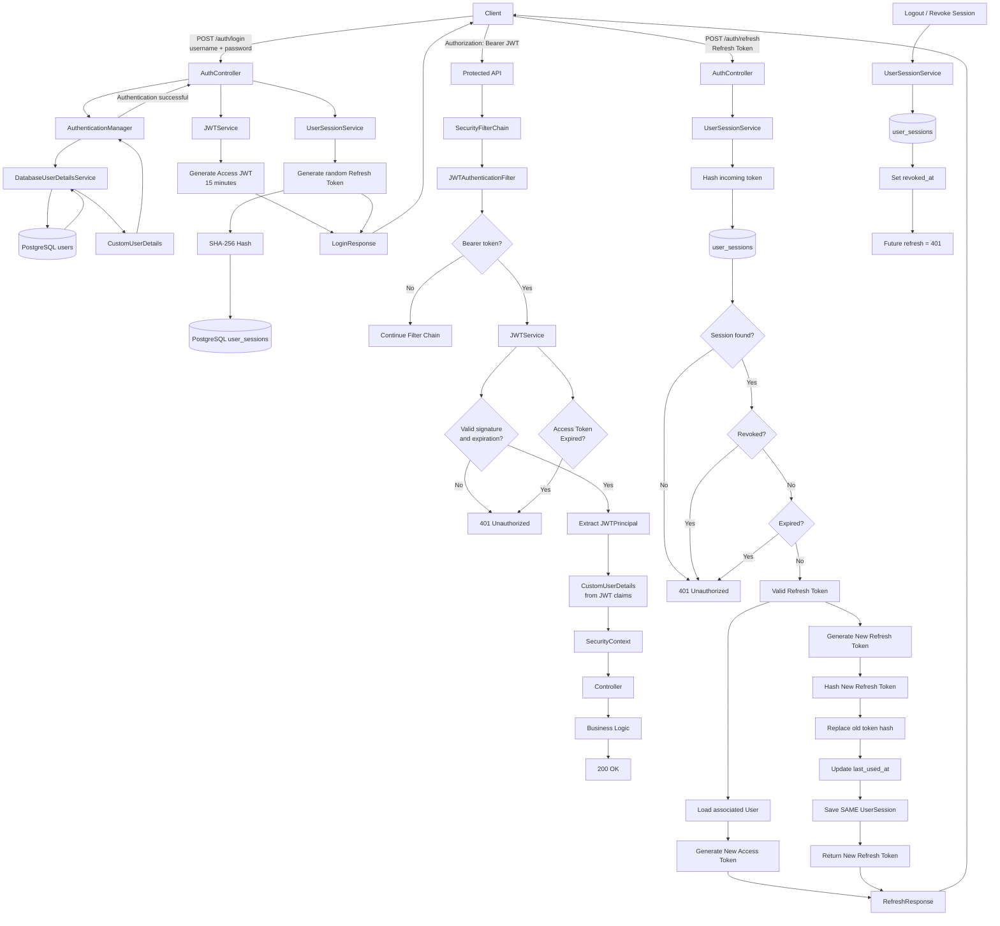

# Spring Boot Expense Tracker — Authentication & JWT

A Spring Boot expense tracker demonstrating modern backend practices, including **Spring Security, JWT authentication, refresh tokens, refresh-token rotation, PostgreSQL, Flyway, JPA, and stateless API security**.

The authentication system was intentionally built incrementally to understand what Spring Security is doing underneath its defaults rather than simply relying on auto-configuration.

---

## Authentication Architecture

The authentication system uses two types of tokens:

* **Access Token** — short-lived JWT used to access protected APIs.
* **Refresh Token** — long-lived, opaque token used to obtain a new access token.

The access token currently expires after **15 minutes**, while refresh sessions currently have a **30-day lifetime**.



---

## 1. Login

The client sends credentials to:

```http
POST /auth/login
Content-Type: application/json

{
  "username": "admin",
  "password": "********"
}
```

The request goes through Spring Security's `AuthenticationManager`.

```text
Client
  │
  │ username + password
  ▼
AuthController
  │
  ▼
AuthenticationManager
  │
  ▼
DatabaseUserDetailsService
  │
  ▼
UserRepository
  │
  ▼
PostgreSQL
  │
  ▼
CustomUserDetails
  │
  ▼
PasswordEncoder
```

If authentication succeeds, the application generates:

```text
Access Token
+
Refresh Token
```

The response looks conceptually like:

```json
{
  "accessToken": "...",
  "refreshToken": "..."
}
```

---

## 2. Access Token

The access token is a signed JWT.

The current claims are approximately:

```json
{
  "sub": "admin",
  "uid": "019f47ca-...",
  "role": "ADMIN",
  "iat": 1783893415,
  "exp": 1783894315
}
```

The token contains enough information for the application to reconstruct the authenticated user's security identity without querying the database on every API request.

### Why?

For a normal protected request:

```text
JWT
 │
 ▼
JWTAuthenticationFilter
 │
 ▼
Validate JWT
 │
 ▼
Extract JWTPrincipal
 │
 ▼
CustomUserDetails
 │
 ▼
SecurityContext
 │
 ▼
Controller
```

There is **no database lookup** in this path.

This is one of the major benefits of our JWT-based authentication design.

---

## 3. JWT Authentication Filter

The custom filter is registered before Spring Security's `UsernamePasswordAuthenticationFilter`:

```java
.addFilterBefore(
    jwtAuthenticationFilter,
    UsernamePasswordAuthenticationFilter.class
)
```

The filter:

1. Reads the `Authorization` header.
2. Checks for `Bearer`.
3. Validates the JWT.
4. Extracts the principal.
5. Creates `CustomUserDetails`.
6. Places the authentication into the `SecurityContext`.
7. Continues the filter chain.

Conceptually:

```text
Authorization: Bearer <JWT>
                │
                ▼
       JWTAuthenticationFilter
                │
                ▼
          JWTService
                │
        ┌───────┴───────┐
        │               │
      Invalid          Valid
        │               │
        ▼               ▼
       401       JWTPrincipal
                        │
                        ▼
                SecurityContext
```

---

## 4. Access Token Expiration

The access token is intentionally short-lived.

Current lifetime:

```text
15 minutes
```

After expiration:

```text
Client
  │
  │ expired JWT
  ▼
JWTAuthenticationFilter
  │
  ▼
JWTService
  │
  ▼
Token expired
  │
  ▼
401 Unauthorized
```

The client does **not** need to ask the user for their password again.

Instead, it can use the refresh token.

---

# 5. Refresh Token

Unlike the access token, the refresh token is an **opaque random value**.

Example:

```text
068qm1ObvWUe4XGiWx-7TQyyoNfKRc5HvBuU39eVv4s
```

The server does not store this raw value.

Instead:

```text
Raw Refresh Token
        │
        ▼
     SHA-256
        │
        ▼
refresh_token_hash
```

The database contains something like:

```text
9147865562814002bde65322ba00e55cd96cbb45dbfc817c2e6dba5ff1ab4374
```

This means a database compromise does not immediately expose usable refresh tokens.

---

# 6. User Sessions

Refresh tokens are associated with persistent sessions.

Current table:

```text
user_sessions

id
user_id
refresh_token_hash
user_agent
ip_address
created_at
last_used_at
expires_at
revoked_at
```

A session represents a **login/device session**, rather than every individual refresh-token generation.

For example:

```text
User #1

Session #1 → Chrome
Session #2 → Phone
Session #3 → Tablet
```

This allows individual sessions to be revoked.

For example:

```text
Chrome  → revoked
Phone   → active
Tablet  → active
```

---

# 7. Multiple Simultaneous Sessions

A user can have multiple refresh tokens simultaneously.

```text
                    User
                     │
        ┌────────────┼────────────┐
        ▼            ▼            ▼
     Chrome        Phone        Tablet
        │            │            │
   Session #1    Session #2    Session #3
        │            │            │
   Refresh A     Refresh B     Refresh C
```

This is important for session management.

Logging out from Chrome does not have to invalidate the user's phone session.

---

# 8. Refresh Flow

When the access token expires:

```http
POST /auth/refresh
Content-Type: application/json

{
  "refreshToken": "..."
}
```

The server:

```text
Refresh Token
      │
      ▼
SHA-256
      │
      ▼
Find UserSession
      │
      ├── Not found ──► 401
      │
      ├── Revoked ────► 401
      │
      ├── Expired ────► 401
      │
      ▼
Valid Session
      │
      ▼
Associated User
      │
      ▼
Generate New Access Token
```

---

# 9. Refresh Token Rotation

Refresh tokens are **rotated** after successful use.

Suppose the client currently has:

```text
Refresh Token A
```

The database contains:

```text
hash(A)
```

After a successful refresh:

```text
Refresh A
    │
    ▼
Validate
    │
    ├──────────────► New Access Token
    │
    ▼
Generate Refresh B
    │
    ▼
Hash B
    │
    ▼
Replace hash(A)
with hash(B)
```

The same `UserSession` remains:

```text
Before:

Session #1
refresh_token_hash = hash(A)


After:

Session #1
refresh_token_hash = hash(B)
```

The session itself is not recreated.

---

# 10. Why Rotation Matters

Without rotation:

```text
Refresh A
   │
   ├── refresh ──► Access B
   │
   ├── refresh ──► Access C
   │
   └── refresh ──► Access D
```

Refresh token A remains usable for its entire lifetime.

With rotation:

```text
Refresh A
   │
   ▼
Refresh B
   │
   ▼
Refresh C
   │
   ▼
Refresh D
```

Each refresh token is intended to be used once.

Therefore:

```text
A → B
```

means the old `A` is no longer valid.

---

# 11. Refresh Token Reuse

Rotation also gives us an important security signal.

Suppose an attacker steals Refresh Token A.

Both the legitimate client and attacker possess:

```text
Refresh A
```

If the attacker uses it first:

```text
Attacker
   │
   │ Refresh A
   ▼
Server
   │
   ▼
A → B
```

The legitimate client still has A.

If it later sends A:

```text
Refresh A
   │
   ▼
Server
   │
   ▼
hash(A) is not the current token of any session
   │
   ▼
hash(A) found in used_refresh_tokens
   │
   ▼
Refresh token reuse detected
```

Every time a token is rotated, the hash of the old token is saved in `used_refresh_tokens`, linked to its session.

A previously valid token being presented again can indicate that a token was stolen, so the server:

```text
Refresh Token Reuse Detected
            │
            ▼
Possible Token Theft
            │
            ▼
Revoke the Session
            │
            ▼
401 Unauthorized
```

The whole session is revoked, so both the attacker and the legitimate client are logged out and the real user must log in again.
A token the server has never issued is simply rejected with `401 Unauthorized`.

Other details of `UserSessionService.rotateRefreshToken`:

- The session row is locked (`findForUpdateByRefreshTokenHash`) inside one transaction, so two concurrent refreshes with the same token cannot both succeed. The second one waits, then sees the token as already used.
- The session revoke is not rolled back when the reuse is rejected (`noRollbackFor`).
- A revoked or expired session is rejected with `401`.
- If the user has been disabled, the session is revoked and the refresh is rejected, so re-enabling the account does not bring the session back.
- `POST /auth/logout` revokes the session of the given refresh token. It always returns `204`, even for unknown tokens, and the access token stays valid until it expires.
- A nightly job (`UserSessionCleanup`, from 3AM) deletes sessions that expired or were revoked more than 7 days ago, together with their used token hashes. Active sessions are never deleted.

---

# 12. Session Revocation

A session can be revoked by setting:

```text
revoked_at = CURRENT_TIMESTAMP
```

For example:

```sql
UPDATE user_sessions
SET revoked_at = CURRENT_TIMESTAMP
WHERE id = 1;
```

The refresh token associated with that session can no longer be used.

Clients log out by sending their refresh token:

```http
POST /auth/logout
Content-Type: application/json

{
  "refreshToken": "..."
}
```

This revokes only that session (other devices stay logged in) and always returns
`204 No Content`, even for unknown tokens, so the endpoint can't be used to probe tokens.
No access token is required, so a client can still log out after its JWT has expired.
The access token itself stays valid until it expires (at most 15 minutes).

```text
Refresh Token
      │
      ▼
UserSession
      │
      ▼
revoked_at != NULL
      │
      ▼
401 Unauthorized
```

---

# 13. Authentication vs Authorization

The project also distinguishes between authentication and authorization.

### Authentication

> "Who are you?"

Examples:

```text
Username + Password
JWT
Refresh Token
```

Failure:

```http
401 Unauthorized
```

### Authorization

> "Are you allowed to do this?"

For example:

```text
Authenticated user
        │
        ▼
ROLE_USER
        │
        ▼
Admin-only endpoint
        │
        ▼
403 Forbidden
```

This distinction is important when working with Spring Security.

---

# 14. Spring Security Responsibilities

The application intentionally separates responsibilities.

```text
Spring Security
│
├── Authentication
│   ├── AuthenticationManager
│   ├── UserDetailsService
│   └── PasswordEncoder
│
├── JWT authentication
│   └── JWTAuthenticationFilter
│
├── Authorization
│   ├── SecurityContext
│   ├── Roles
│   └── @PreAuthorize
│
└── HTTP security failures
    ├── 401 Unauthorized
    └── 403 Forbidden
```

Meanwhile, application-level exceptions are handled separately:

```text
GlobalExceptionHandler
│
├── ResourceNotFoundException → 404
├── ValidationException       → 400
├── BusinessRuleException     → 409
└── Other application errors
```

This keeps security infrastructure separate from business-domain error handling.

---

# 15. Stateless API

The application uses:

```java
.sessionManagement(session ->
    session.sessionCreationPolicy(
        SessionCreationPolicy.STATELESS
    )
)
```

Therefore the server does not use an HTTP session to maintain authentication state.

The authentication state is represented by:

```text
Access JWT
```

while long-lived authentication continuity is represented by:

```text
Refresh Token + UserSession
```

This is why the application can remain stateless for normal API authentication while still supporting long-lived login sessions.

---

# 16. Complete Lifecycle

The complete lifecycle can be summarized as:

```text
                    ┌──────────────┐
                    │    LOGIN     │
                    └──────┬───────┘
                           │
               username + password
                           │
                           ▼
                  AuthenticationManager
                           │
                           ▼
                 DatabaseUserDetailsService
                           │
                           ▼
                      User Database
                           │
                           ▼
                    Authentication OK
                           │
             ┌─────────────┴─────────────┐
             ▼                           ▼
       Access Token                 Refresh Token
        15 minutes                    30 days
             │                           │
             ▼                           ▼
        API Requests                UserSession
             │                           │
             ▼                           ▼
     JWTAuthenticationFilter        PostgreSQL
             │                           │
             ▼                           │
      Validate JWT                       │
             │                           │
        ┌────┴────┐                      │
        ▼         ▼                      │
     Valid      Expired                  │
        │         │                      │
        ▼         ▼                      │
 SecurityContext  401                    │
        │                                │
        ▼                                │
    Controller                           │
        │                                │
        ▼                                │
      200 OK                             │
                                         │
                                  Access token expires
                                         │
                                         ▼
                                  /auth/refresh
                                         │
                                         ▼
                                  Validate session
                                         │
                              ┌──────────┴──────────┐
                              ▼                     ▼
                           Invalid                Valid
                              │                     │
                              ▼                     ▼
                             401              Rotate token
                                                    │
                                       ┌────────────┴────────────┐
                                       ▼                         ▼
                                New Access JWT             New Refresh Token
                                       │                         │
                                       └────────────┬────────────┘
                                                    │
                                                    ▼
                                                 Client
                                                    │
                                                    ▼
                                                Repeat
```

---

# 17. User Accounts, Roles and Admin Endpoints

Every error below uses the same JSON body as the rest of the API: `{"code": "...", "message": ...}`.
Request bodies that fail bean validation (blank fields, missing `version`) return `400 VALIDATION_ERROR`.

## Registration

```http
POST /auth/register
Content-Type: application/json

{ "username": "alice", "password": "a-long-password" }
```

* No access token needed. Always creates a `USER` (never an `ADMIN`), enabled.
* `201 Created` with `{ id, username, role, createdAt }`. `id` is the user's `unique_id` (UUID), never the
  database id. No tokens are returned; the client calls `/auth/login` next.
* `409 USERNAME_TAKEN` if the name exists in any letter case. Usernames are unique ignoring case
  (index added in V11), so `alice` is taken once `Alice` exists. Login matches the username in any case.
* `400 INVALID_PASSWORD` if the password has fewer than 12 characters, more than 72 bytes in UTF-8
  (the BCrypt limit), or equals the username ignoring case. The same rules apply to a password change.
* `username` is required and at most 100 characters (otherwise `VALIDATION_ERROR`).
* There is no login throttling yet, so registration is not rate limited either.

## Roles

There are two roles, `USER` and `ADMIN`. The role is stored in the user row and copied into the
access token as the `role` claim.

| Path | Who |
| --- | --- |
| `/auth/login`, `/auth/register`, `/auth/refresh`, `/auth/logout` | anyone |
| `/users/me`, `/users/me/**` | any authenticated user |
| `/users`, `/users/**` | `ADMIN` only (`403 ACCESS_DENIED` otherwise) |
| everything else (expenses) | any authenticated user |

The admin controller methods also carry `@PreAuthorize("hasRole('ADMIN')")`, so a later change to the URL
rules cannot open them up. A missing or invalid access token gives `401 AUTHENTICATION_REQUIRED`.
The first admin is created at startup from `ADMIN_USERNAME` / `ADMIN_PASSWORD`; there is no endpoint that
creates admins, but an existing admin can promote a user with `PATCH /users/{id}`.

## Self-service endpoints (any authenticated user)

```http
GET /users/me
```

`200` with `{ id, username, role, createdAt }`. `404 USER_NOT_FOUND` if the account was removed after the
token was issued.

```http
POST /users/me/password
Content-Type: application/json

{ "currentPassword": "...", "newPassword": "..." }
```

* `204 No Content` on success.
* `400 INVALID_CURRENT_PASSWORD` if the current password is wrong. This is deliberately 400, not 401,
  so a client does not mistake it for an expired login.
* `400 INVALID_PASSWORD` if the new password breaks the rules above.
* A password change revokes **every** session of the user, including the caller's own. All refresh
  tokens stop working and the client must log in again with the new password. The current access token
  keeps working until it expires (at most 15 minutes).

## Admin endpoints (`ADMIN` only)

In these paths `{id}` is the user's `unique_id` (UUID), never the database id.

Every admin endpoint also checks the caller against the database: an admin who has been demoted or
disabled still holds an access token that says `ADMIN` (until it expires), and gets `403 ACCESS_DENIED`
from all of them, so they cannot read users or undo their own demotion.

```http
GET /users?username=ali&enabled=true&page=0&size=20
```

* `username` is a case-insensitive substring match (`%` and `_` are taken literally); `enabled` filters
  exactly; both are optional. Results are ordered oldest first.
* `page` is zero-based (default 0), `size` defaults to 20 (maximum 100). Anything outside that range is
  `400 INVALID_PAGE`.
* `200` with `{ users: [...], page, size, total, totalPages }`. Each user is
  `{ id, username, role, enabled, version, createdAt, lastModified }`. The password hash is never returned.

```http
GET /users/{id}
```

`200` with the same admin user shape, or `404 USER_NOT_FOUND`.

```http
PATCH /users/{id}
Content-Type: application/json

{ "version": 0, "enabled": false, "role": "USER" }
```

* `version` is required (take it from the GET response); `enabled` and `role` are each optional, but at
  least one must be given or the answer is `400 EMPTY_PATCH`.
* `200` with the updated admin user shape and the incremented `version`.
* `409 CONCURRENT_MODIFICATION` if `version` is stale.
* `409 CANNOT_MODIFY_SELF` if an admin tries to disable or demote themselves.
* `409 LAST_ADMIN` if the change would disable or demote the last enabled admin. The enabled admins are
  locked (`SELECT ... FOR UPDATE`) first, so two admins demoting each other at the same moment are
  serialized and the second one is refused (with `403`, since by then it is no longer an admin).
* `404 USER_NOT_FOUND` for an unknown id.

## What revokes sessions

| Event | Sessions revoked |
| --- | --- |
| `POST /auth/logout` | the one session of that refresh token |
| refresh token reuse | the session that was reused |
| refresh by a disabled user | that session |
| `POST /users/me/password` | all sessions of the user, including the caller's |
| `PATCH /users/{id}` that disables the user | all sessions of that user |
| `PATCH /users/{id}` that demotes `ADMIN` to `USER` | all sessions of that user |
| `PATCH /users/{id}` that enables or promotes | none |

## Role changes and the access token

The access token is never checked against the database, so the role inside it is whatever it was at
issue time. A role change therefore takes effect when the user's next access token is issued:

* **Demotion or disabling** revokes the user's sessions, so the next `/auth/refresh` fails with 401. The
  already-issued access token keeps its old role (and keeps working) until it expires, at most 15 minutes.
  The admin endpoints are the exception: they check the caller in the database and refuse with 403.
* **Promotion** revokes nothing. The user keeps the `USER` token until it expires; the next
  `/auth/refresh` builds the new access token from the database and carries the `ADMIN` role.

---

## Current Authentication Stack

```text
Spring Boot
    │
    ├── Spring Security
    │
    ├── JWT
    │
    ├── PostgreSQL
    │
    ├── Spring Data JPA
    │
    └── Flyway
```

### Security components

```text
auth/
├── AuthController
│
├── config/
│   ├── SecurityConfig
│   └── PasswordConfig
│
├── props/
│   ├── JWTProperties
│   └── AdminBootstrapProperties
│
├── mapper/
│   └── CustomUserDetailsMapper
│
└── security/
    ├── JWTAuthenticationFilter
    ├── JWTService
    ├── JWTPrincipal
    ├── CustomUserDetails
    └── DatabaseUserDetailsService

session/
├── UserSessionService
├── RefreshTokenGenerator
├── RefreshTokenHasher
└── job/
    └── UserSessionCleanup
```

---

## Authentication Goals

This implementation intentionally demonstrates the following principles:

* Stateless REST authentication
* Short-lived access tokens
* Long-lived refresh tokens
* Refresh-token hashing
* Refresh-token rotation
* Per-device/session authentication
* Session-level revocation
* JWT authentication without a database lookup on every request
* Database lookup during initial credential authentication
* Separation of authentication and authorization
* Separation of Spring Security errors from business exceptions
* Explicit Spring Security configuration instead of relying entirely on defaults

---

## Roadmap

The authentication system is being developed incrementally.

### Completed

* [x] Spring Security configuration
* [x] Disable form login
* [x] Disable HTTP Basic
* [x] Stateless sessions
* [x] Database-backed `UserDetailsService`
* [x] Password authentication
* [x] Custom `UserDetails`
* [x] JWT generation
* [x] JWT validation
* [x] JWT authentication filter
* [x] Access-token expiration
* [x] JWT authentication without DB lookup
* [x] Refresh-token generation
* [x] Hashed refresh-token storage
* [x] Persistent user sessions
* [x] Multiple simultaneous sessions
* [x] Session-level revocation
* [x] `/auth/refresh`
* [x] Refresh-token rotation
* [x] Refresh-token reuse detection
* [x] Rotation/concurrency hardening
* [x] `/auth/logout`
* [x] `POST /auth/register`, roles, `/users/me`, password change
* [x] Admin user endpoints (`/users`) with session revocation

### Next

* [ ] Revoke individual sessions
* [ ] Revoke all sessions
* [ ] Session management API
* [ ] Further authentication/security hardening
* [ ] Additional authorization rules

---

## Core Idea

The most important concept behind the architecture is:

```text
Password
   │
   └── used during LOGIN

Access Token
   │
   └── used for normal API requests

Refresh Token
   │
   └── used to obtain new access tokens

UserSession
   │
   └── controls long-lived authentication,
       device sessions, rotation, and revocation
```

The result is a system where **normal API requests are fast and stateless**, while long-lived authentication remains **revocable and manageable through persistent refresh-token sessions**.
